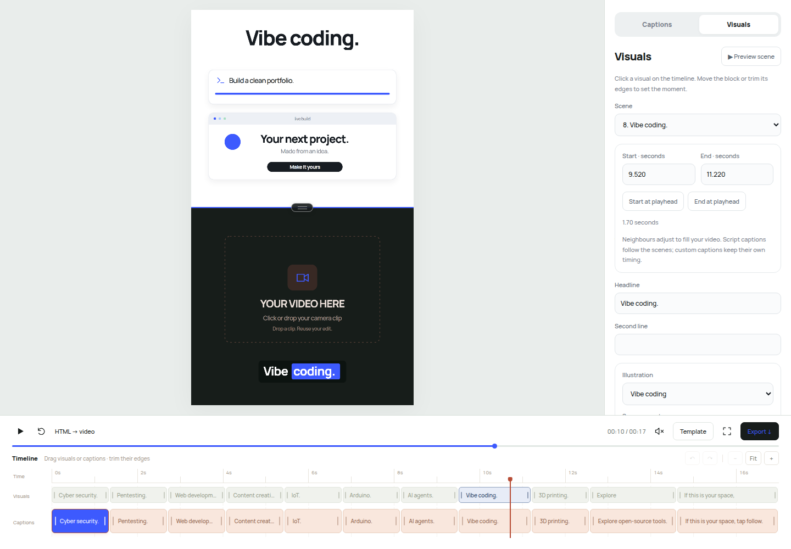
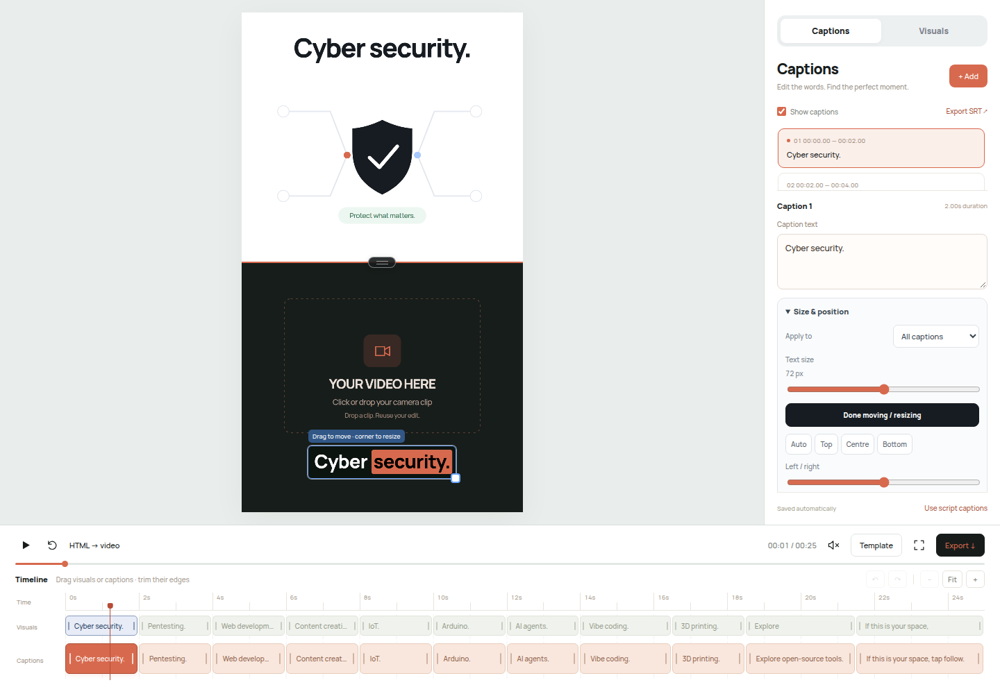

# HTML Video Explainer · v3

Explain a concept to your agent and get an HTML video with a design and motion language chosen for that content. The skill supports research-led product UI films, connected abstract showreels, business explainers, graphic loops, and your existing editable split-video workflow. The agent plans a clear story, creates suitable visual explanations, finds or creates relevant assets, adds timed sound and captions, and renders an MP4 when the required tools are available.

Includes the upgraded `about-this-page.html` editor and the original `video1.html` visual style. Edit both visuals and captions, resize/move captions in the preview, drag/trim timeline blocks, upload scene images, adjust colors/size/position, and save those changes in a template. Uploaded camera video automatically fits the reel length while footage and voice stay at normal 1× speed. Explicit second-by-second plans keep their times instead of being silently stretched. The supplied stories are demonstrations to replace for your own concept.



## Install

Extract `html-video-explainer.zip`, open a terminal in the extracted `html-video-explainer` folder, and run one command for your agent:

```sh
# This Codex environment / CODEX_HOME-based installations
python3 scripts/install.py --agent codex

# Shared Agent Skills directory (modern Codex and Cursor)
python3 scripts/install.py --agent shared

# Claude Code
python3 scripts/install.py --agent claude

# Cursor personal skill
python3 scripts/install.py --agent cursor
```

Each command installs **html-video-explainer and session-story together** in that agent’s skill directory. Choose the directory your agent actually discovers; installing several same-named copies can create duplicate entries. Start a new agent session or reload its skills after installation.

| Option | User-level destination |
| --- | --- |
| `codex` | `$CODEX_HOME/skills/html-video-explainer`, or `~/.codex/skills/html-video-explainer` when unset; matches this workspace's configured skill catalog |
| `shared` | `~/.agents/skills/html-video-explainer` |
| `claude` | `~/.claude/skills/html-video-explainer` |
| `cursor` | `~/.cursor/skills/html-video-explainer` |

The current [Codex documentation](https://developers.openai.com/codex/skills/) lists `~/.agents/skills` and repository `.agents/skills` locations. The explicit `codex` option supports the CODEX_HOME/legacy catalog used by this installation; use `shared` for the documented common directory when appropriate. [Claude Code's documentation](https://code.claude.com/docs/en/skills) lists its personal and project skill folders. [Cursor's documentation](https://cursor.com/help/customization/skills) lists its own folders and compatible Agent Skills folders.

To install into a particular project or another agent's skill folder:

```sh
python3 scripts/install.py --target /path/to/project/.agents/skills/html-video-explainer
```

The `--target` names the main skill folder; `session-story` installs beside it. Preview both destinations with `--dry-run`. A different existing copy is not overwritten silently. Add `--replace` to install an update while keeping the old folder as a timestamped backup. For a standard `skills` directory, backups go in its parent’s `skill-backups` folder so an old copy does not appear as a second installed skill. Installation is local and does not call a service or require an API key. The companion snapshot is bundled and checksum-verified; installation does not run its setup scripts or read any history.

The required entry file is **`SKILL.md`**, singular, with standard YAML frontmatter. A file called `skills.md` alone is not the normal skill package format. The rest of the folder must travel with it because the instructions use the bundled template and scripts. See the [Agent Skills specification](https://agentskills.io/specification).

## Included session-story dependency

Your requested upstream command is:

```sh
npx skills add heygen-com/hyperframes-community-skills --skill session-story
```

The included Python installer automatically installs a pinned snapshot of that same upstream skill beside this one. The archived sources are unchanged; the upstream license, engine notices, revision and checksums are included. Installation normalizes one placeholder in its metadata description for Codex validation, preserves the exact original, and leaves the workflow unchanged. See [source and routing](references/session-story.md) and `companions.lock.json`. No npx/network call is needed to install the bundled snapshot.

Use **this package’s `install.py`** for automatic companion installation. A generic skill manager that only copies the parent folder does not run our installer hook; run the helper or install `session-story` separately with the command above. The companion’s npm/HyperFrames/music setup is a later, separate runtime step governed by its own instructions.

It is for films about real user/agent sessions. It is not automatically invoked for an ordinary product or concept video, and installation does not authorize transcript access.

## Use

In Codex:

```text
$html-video-explainer
Explain how binary search works for beginners. Make a 25-second reel
with clear moving diagrams, my camera section below, and editable captions.
```

In Claude Code or Cursor, invoke `/html-video-explainer` with your concept. Automatic discovery can also select it for relevant video-creation requests.

For an agent that does not automatically discover skills, give it the folder and say:

```text
Read /path/to/html-video-explainer/SKILL.md and follow it to create
an animated HTML video explaining [my concept].
```

The instructions are portable Markdown and use standard Python/JavaScript files. Automatic installation, tool availability, and execution support still depend on the host agent. An agent needs workspace/file access to create the project; a text-only chat cannot install or run it by reading the name alone.

You can keep the prompt short, or specify duration, audience, language, brand, aspect ratio, camera layout, references, and desired exports. Defaults are 25 seconds, 9:16, an equal adjustable split, white/charcoal/coral, and conversational narration. User instructions override these defaults.

To send only concepts after a one-time setup, give your chosen agent this project instruction:

```text
For this video project, treat my topic messages as requests to create an
editable HTML video. Follow /path/to/html-video-explainer/SKILL.md.
When I give only a concept, use its defaults and create the files.
```

That makes the intent explicit for agents that would otherwise answer a bare topic as a text explanation. It does not change unrelated agents or projects.

Other examples:

```text
Use html-video-explainer to explain the water cycle to a 12-year-old.
Use a simple illustrated landscape and clearly show evaporation,
condensation, and rain. Deliver an editable 30-second HTML reel.
```

```text
Use html-video-explainer to show our app's before-and-after workflow.
Use the screenshots in this folder, our blue brand colour, and a
20-second edit. Keep the caption timeline and camera framing tools.
```

## Resize and move captions

In a generated project, open **Captions → Size & position**. Choose **All captions** or **This caption only**. Change text size, use top/centre/bottom/automatic placement, or enable **Move / resize in preview** and drag the caption or its corner. Arrow keys move it; +/- resize it. Appearance options include word highlight, clean box, outlined text, text/background colors, opacity, and line width.



Undo/Redo includes appearance edits. Styling stays separate from words and timing, and automatic captions remain automatic. Save template retains styling; exported video uses the same renderer. SRT keeps text/timing only.

```sh
python3 scripts/create_project.py --output ./my-caption-video --title "My concept" --caption-size 72 --caption-position bottom
```

Example request: “Use 72px captions near the bottom. Make the hook caption 92px and centred. Keep every caption editable and do not change my voice speed.” The agent can set global/per-cue appearance, and you can adjust it later in the editor.

## Let the agent choose suitable motion

```text
$html-video-explainer Here is my content: [your content].
Choose the most suitable visual direction and motion for this audience.
Name the concept and recurring object, show the timed storyboard,
then build. Use my brand/reference when supplied and keep facts real.
```

The agent chooses a mechanism that serves the content rather than copying a generic dot/toggle or one demo into every project. [Direction selection](references/motion-direction.md) explains the choices. [Four refined prompt recipes](references/prompt-recipes.md) cover product UI, connected technique films, business explainers and graphic loops. Exact user instructions override their defaults.

## Full-frame motion-film mode

For a single-file 1920×1080 film with deterministic `window.seek(t)`:

```sh
python3 scripts/create_motion_film.py --output ./film.html --title "My motion concept" --duration 15 --bpm 120
```

This makes an authoring shell; the agent implements the actual storyboard and marks it complete. It includes analytical easing, an embedded licensed font, and an OfflineAudioContext WAV composer. The strict renderer supports one frame per beat, contact sheets, random-access determinism checks, 60fps, and three temporal samples averaged with ffmpeg before audio mux:

```sh
node scripts/render_motion_film.cjs ./film.html --preview
# Inspect the beat frames/contact sheets, fix issues, and regenerate if needed.
node scripts/render_motion_film.cjs ./film.html --reviewed
```

Use `CHROME_PATH`, `PLAYWRIGHT_MODULE`, and `FFMPEG_PATH` if tools live outside the normal PATH. Read [the film build guide](references/motion-film-build.md). The `--reviewed` flag is the agent’s assertion that it inspected the current hash-matched preview, not an automatic visual-quality rating. `--allow-demo` exists only for pipeline tests. The regular split editor, captions, visual/timing customization and normal-speed camera workflow remain available.

## Give exact seconds

```text
$html-video-explainer Create a 17-second reel in the about-this-page style.
0–2s: reveal “Build with me”.
2–6s: animate a code editor turning into a live page.
6–8s: show an Arduino board; the LED is fully on at 7.5s.
8–13s: show my 3D printer image with a clean nozzle/layer animation.
13–17s: show @ducky.logs, move a cursor to Follow, and click at 15s.
Use the cobalt palette. Camera below at normal speed.
Keep these exact times; include visual and caption editing controls.
```

The agent fills any unspecified intervals, compiles a timing plan, then implements the actual animations. Global scene start/end and local animation/sound beats are distinct. Exact timing turns upload matching off; enable matching only when you want the whole edit to fit a different clip length. See [timestamp format and example](references/timestamped-direction.md).

## Style, colors, and realistic assets

```sh
python3 scripts/create_project.py --output ./my-video --title "My concept" --style about --palette cobalt --duration 17 --creator @ducky.logs
python3 scripts/create_project.py --output ./photo-video --title "My concept" --style video1 --palette coral
```

Palettes: **coral, cobalt, mint, violet, rose, mono**. All have clean light backgrounds and charcoal typography. Supply `--accent '#YOURHEX'` with a real six-digit hex to override the preset, or pick a palette in **Template → Story + script**. Per-scene accents can be changed in **Visuals**.

For realistic custom imagery, narration, actual 3D models, or exact speech captions, the agent uses available appropriate companion tools. These are optional capabilities, not hidden mandatory installs. [Companion workflow guidance](references/companion-workflows.md) covers `imagegen`, `3d-model-generation`, voice generation, transcription, and Figma when specifically relevant. If unavailable, the agent uses supplied/local assets and explains the specific missing capability. The base template needs no paid service or API key.

## What is included

```text
html-video-explainer/
  SKILL.md                  Agent workflow and defaults
  README.md                 This install/use guide
  agents/openai.yaml        Codex discovery metadata
  references/               Design, template API, assets/audio/export guidance
  scripts/
    create_project.py       Creates about/video1 projects and selects a palette
    apply_timeline.py       Compiles explicit scene windows and local beats
    check_project.py        Checks timing, captions, assets, media freshness, JS
    install.py              Paired local install, checksum check, backups/rollback
    create_motion_film.py   Single-file deterministic film authoring shell
    render_motion_film.cjs  Beat review, offline WAV, 60fps temporal-blur MP4
  assets/template/          Upgraded visual/caption editor and render tools
  assets/styles/video1/     Original photo/code story resources
  assets/examples/         Timing-plan and self-contained full-frame references
  assets/motion-film/       Strict 1920×1080 seek(t) film shell
  assets/companions/        Pinned session-story archive with licenses
  companions.lock.json     Companion source revision and archive checksum
```

The starter's `concept.js` extension lets the agent write new scene renderers without rebuilding playback, captions, and framing. The media tools accept a project image manifest and scene-relative sound cues. A different subject can therefore use a different shot count, duration, explanation, and image set.

The editor preserves proportions as the split changes. The existing starter supports a 30–70% top section and a vertical canvas; a requested landscape or full-frame movie needs the agent to adapt and verify the compositor, not just change its title.

## Tools needed

- Python 3.10+ for the installer, scaffolder, checker, and script/SRT export.
- A modern browser to use the generated HTML editor. It works without a local server or CDN; fonts, photos, and sounds are embedded in local runtime files.
- NumPy and FFmpeg to rebuild the soundtrack and media bundle for a changed storyboard.
- Node.js and Playwright for frame-accurate automated MP4 rendering. The page also has a real-time browser Export button.
- Network/image-generation capabilities when the concept needs new external or custom bitmap assets. Purposeful SVG/code diagrams can be created locally.

The skill does not itself contain an AI model or an API key. Your chosen agent reads the workflow and does the creative/coding work. Copying the starter alone is not a finished explanation.

## Quick project setup

An agent normally runs these steps for you:

```sh
python3 scripts/create_project.py --output ./new-video --title "How binary search works"
```

It then adapts `new-video/assets/codex/template.js` and `concept.js`, updates `video.project.json`, sources the right assets, and rebuilds:

```sh
cd new-video
python3 scripts/make-soundtrack.py
python3 scripts/bundle-media.py
python3 scripts/export-script.py
```

After concept adaptation, set `is_demo` to `false` in `video.project.json` and validate with the skill's `scripts/check_project.py`. Render with the generated project's `npm run render` when Playwright and FFmpeg are available. `FFMPEG_PATH`, `CHROME_PATH`, and `PLAYWRIGHT_MODULE` are optional environment overrides; no machine-specific paths are bundled.

For a complete explicit plan:

```sh
python3 scripts/apply_timeline.py ./new-video ./my-timeline.json
```

Then implement its visual actions and rebuild media. The helper stores timing/data; it does not turn prose into animation by itself. It preserves independent custom captions unless `--reset-captions` is requested. `assets/examples/timeline-tech.json` is a small working plan using the illustrated reference presets.

The generated project renderer supports `npm run render -- --template saved-template.json` for saved image/visual/timing changes, and `--duration SECONDS` for a deliberate duration override. Browser Export includes the selected camera clip; the offline renderer does not recover a private camera file from JSON.

The generated result includes an entry HTML, runtime assets, editable storyboard, recording script, captions/SRT, source credits, and MP4 when rendered. Local browser/template changes persist for reuse; footage stays on the device and must be selected again after reload.

## Assets and verification

The original editing photos are examples and should be replaced when irrelevant to a new concept. Bundled fonts and the recorded keyboard retain their license/credit files. Each new project keeps its own `SOURCES.md`; the skill asks the agent to verify factual claims and asset origins when needed.

The static checker catches unfinished demo status, invalid timings/captions, missing local files, stale media sources, audio-duration mismatch, and JavaScript syntax failures when Node is available. It does not prove the visuals teach the concept or that an MP4 was rendered. Browser inspection, audio checks, and actual render/decode checks supply that evidence.

The package includes static validation for storyboard/timing, custom captions, local assets, source/audio freshness, and JavaScript syntax. Its browser checks exercise both starter styles, palettes, exact scene boundaries, image editing, and normal-speed camera upload. A separate small queue animation provides a new-concept smoke case. Rendered files and installer updates are checked before packaging; automatic discovery in every host agent is not claimed.

The v3 strict-film smoke test used a two-second authoring demo: four beat frames were inspected, random-access determinism passed, OfflineAudioContext produced a non-silent stereo 48kHz WAV, and the three-temporal-sample renderer produced a decoded 1920×1080 H.264/AAC master with exactly 120 frames at 60fps. This verifies the pipeline, not a claim that the neutral demo is an original finished showreel. The renderer probes actual triplet averaging to account for FFmpeg filter warm-up differences. Paired installer tests covered repeat installation, a missing companion, conflict refusal, backups, and corrupt companion checksum rejection. No companion runtime setup or private-history harvest was run.
